# Tyba Technical Test: Universities

Flutter app that lists universities from a remote JSON, lets the user switch between list and grid, and open a detail screen where an image and a student count can be assigned to a university.

## Screenshots

### Android

|  | List | Grid | Detail |
| :---: | :---: | :---: | :---: |
| Light | 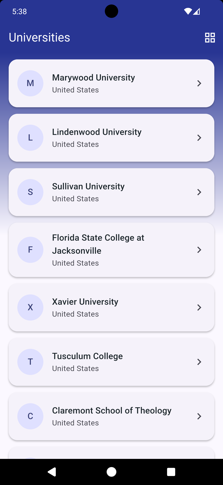 | 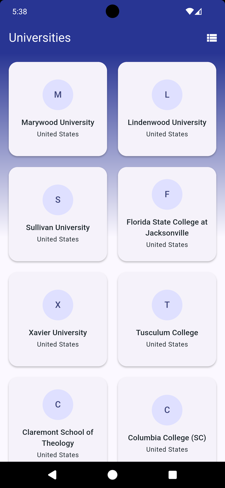 | 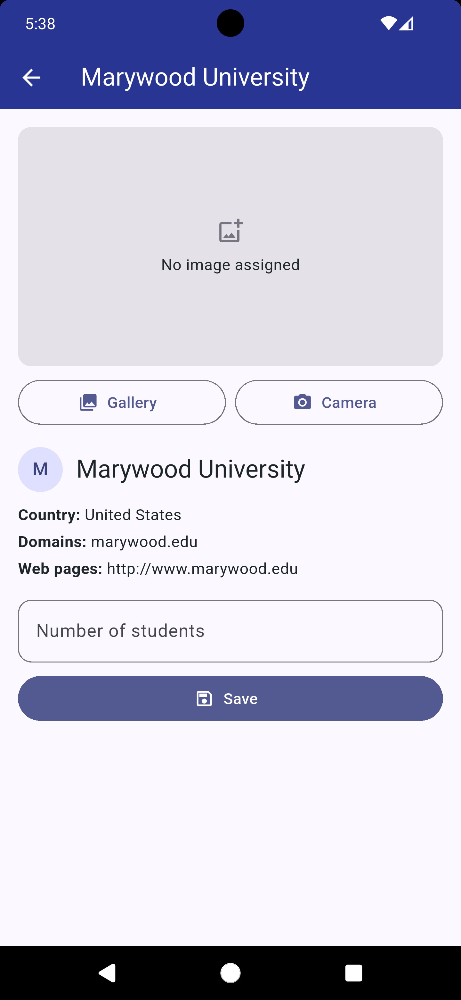 |
| Dark | 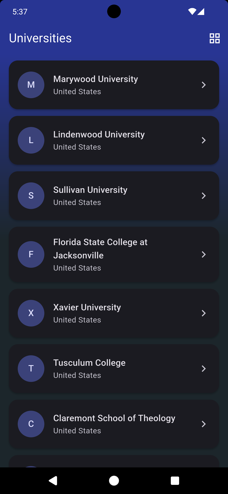 | 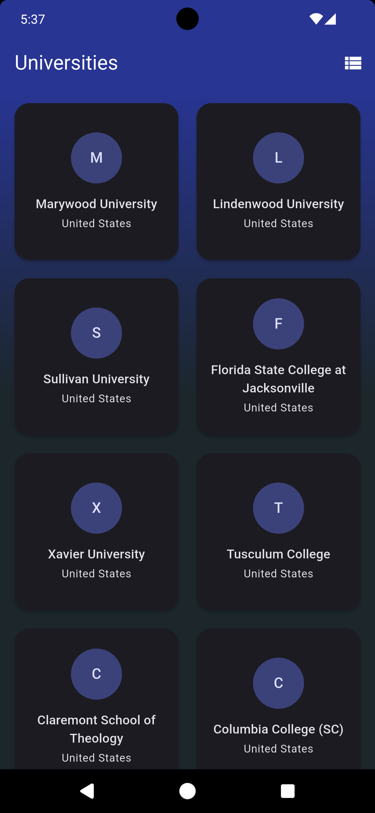 | 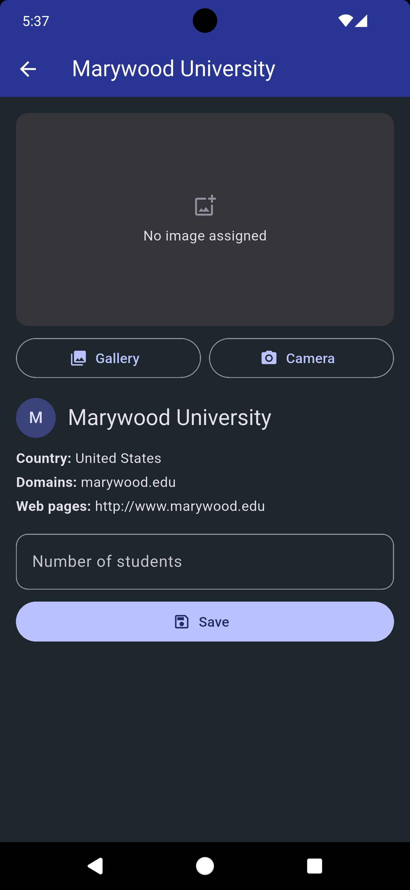 |

### iOS

|  | List | Grid | Detail |
| :---: | :---: | :---: | :---: |
| Light | 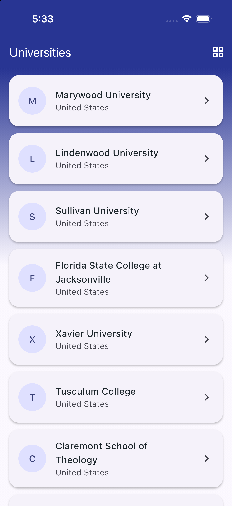 | 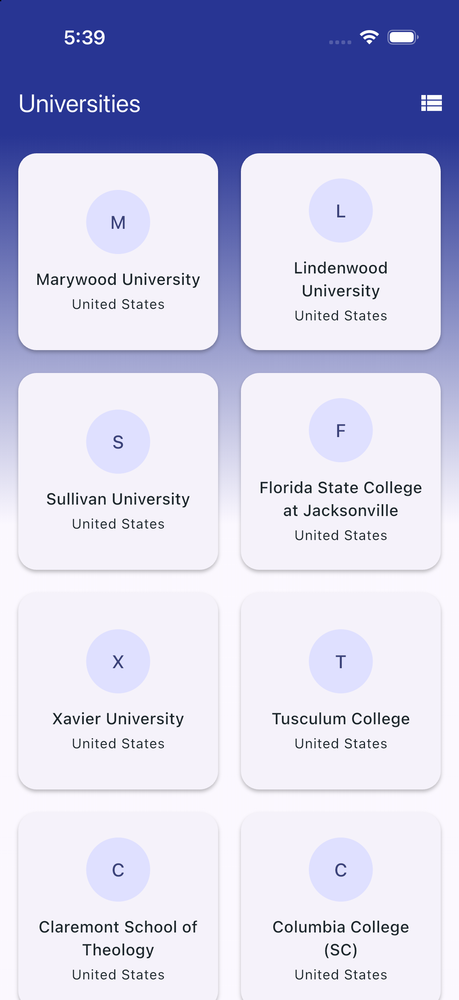 | 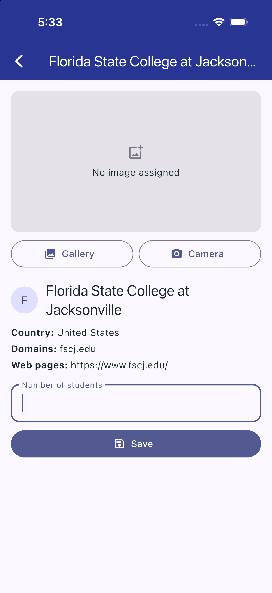 |
| Dark | 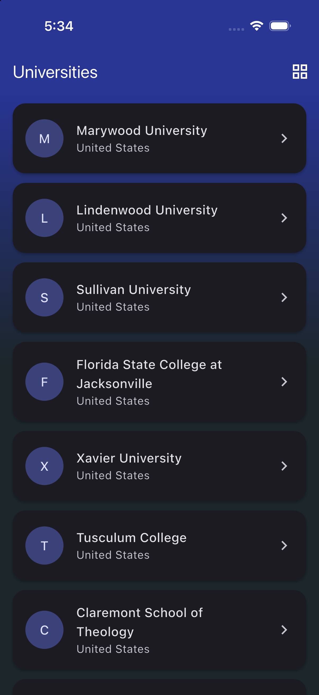 | 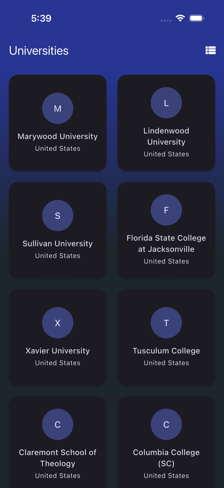 | 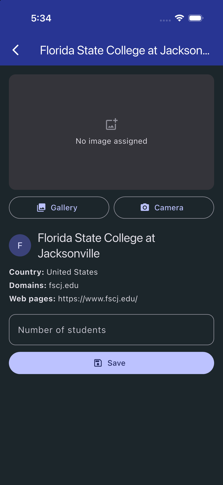 |

## Features

- Branded startup: native launch screen, then an animated splash that prefetches the universities.
- Universities list loaded from `https://tyba-assets.s3.amazonaws.com/FE-Engineer-test/universities.json`.
- Toggle between `ListView` and `GridView`.
- Infinite scroll: 20 items at a time, hand-written (no external library).
- Detail screen per university.
- Assign an image from the gallery or the camera.
- Enter the number of students, validated (required, integer, between 1 and 10,000,000).
- Loading (skeleton), error, empty and data states, with a load-more indicator.
- Tyba light and dark themes (follow the system), portrait only.
- Animated transitions: fade + slide between screens, Hero on the university initial avatar and name, list/grid cross-fade.
- No persistence: image and student count live only for the current session.

## Getting started

### Requirements

- Flutter with Dart SDK `^3.13.5` (check with `flutter --version`; `flutter doctor` should be clean for your target).
- Internet access at runtime: the universities JSON is fetched from S3 on every launch.
- A target device: iOS simulator/device (needs macOS + Xcode) or Android emulator/device (needs Android Studio SDK).
- A camera is optional: on simulators/emulators use the gallery option.

| Platform | Minimum | Source |
| --- | --- | --- |
| iOS | 15.0 | `IPHONEOS_DEPLOYMENT_TARGET` in `ios/Runner.xcodeproj/project.pbxproj` |
| Android | API 24 (Android 7.0) | `minSdk = flutter.minSdkVersion` in `android/app/build.gradle.kts`, which is 24 in Flutter 3.47; `compileSdk` is 36 |

Android's minimum follows the installed Flutter version, so a different Flutter release may change it.

### Run

```bash
flutter pub get
flutter run          # pick a device or emulator
```

The generated `*.g.dart` files are committed, so no code generation is needed to run the app. Only after changing a `@riverpod` provider:

```bash
dart run build_runner build -d      # or: dart run build_runner watch -d
```

### Quality checks

```bash
flutter analyze
flutter test
```

On a real device or emulator, the gallery and camera need the platform setup described in [Platform setup](#platform-setup).

## Architecture

Layered architecture following the Flutter recommendations: UI (MVVM), Data, and a small Domain layer that both depend on. Dependencies point inwards: `ui` and `data` know `domain`; `domain` knows nothing about Flutter widgets or HTTP.

```
lib/
├── main.dart                 # entry point: ProviderScope around App
├── app/                      # App widget, appRouter provider, theme, infrastructure providers
├── domain/
│   ├── models/               # University, UniversityProfile
│   ├── repositories/         # abstract contracts
│   ├── failures/             # Failure (user-facing error message)
│   └── validators/           # StudentCountValidator
├── data/
│   ├── models/               # UniversityApiModel (JSON shape)
│   ├── services/             # UniversitiesApiService, ImagePickerService
│   └── repositories/         # implementations of the domain contracts
└── ui/
    ├── core/                 # shared LoadingView, ErrorView, EmptyView, Skeleton
    └── features/universities/
        ├── providers/        # list and detail Riverpod providers (+ generated *.g.dart)
        ├── views/            # UniversitiesListView, UniversityDetailView (screens only)
        └── widgets/          # single-purpose widgets: tiles, cards, sections, heroes
test/                         # mirrors lib/, plus test/support/ fakes
```

| Layer | Responsibility |
| --- | --- |
| Services | Stateless wrappers over external APIs (HTTP, image picker). |
| Repositories | Use services, map API models to domain models, translate errors into `Failure`. |
| Providers | Code-generated Riverpod providers (`@riverpod`): small `Future` providers for data, notifiers for UI state, derived providers for what the view shows. They read repositories through providers. |
| Views | Render with `ref.watch` and `AsyncValue.when` (Consumer widgets) and forward user events with `ref.read`. No business logic. |

### Data flow

```
View  ->  Provider  ->  Repository (interface)  ->  Service  ->  HTTP / image picker
 ^           |
 +-- state --+   (ref.watch rebuilds)
```

### Dependency injection and navigation

- `main.dart` runs `ProviderScope(child: App())`. `lib/app/providers.dart` builds the concrete http client, services and repositories as keepAlive providers; tests override them with fakes.
- `App` is a `ConsumerWidget` that watches the `appRouter` provider.
- List state is split into small providers: `universities` (Future), `universitiesLayout`, `visibleCount` and the derived `visibleUniversities`. Detail uses the `university(id)` family Future and the `universityProfileNotifier(id)` family notifier (both auto-dispose).
- `go_router` defines three routes: `/splash` (initial), `/` (list) and `/university/:id` (detail). The splash replaces itself with the list (`go`), so back never returns to it. The list opens the detail with `push`, so back returns to the list; if the detail was opened directly (no history), back navigates to `/`.
- Views and providers depend on the repository interfaces, so tests inject fakes (`test/support/`).
- Providers are code-generated. After changing one, run `dart run build_runner build -d`; the generated `*.g.dart` files are committed.

## Key decisions

- **Sequential `id` in source order.** The JSON has no id and names repeat, so the repository assigns the index of each item before any sort or filter. The detail route uses it as its path parameter.
- **Riverpod with code generation.** `AsyncValue` models loading, error and data explicitly (empty is a data case with an empty list), and state classes are immutable, so states are easy to assert in tests. Riverpod's automatic retry is disabled (`noRetry`): failures surface at once and the user retries with the button.
- **Hand-written infinite scroll.** The list providers page the already loaded list in chunks of 20 (`pageSize`). The view listens to its `ScrollController` and asks for more when less than 200 px remain.
- **Validation in the domain.** `StudentCountValidator` returns an error enum, not text, so the rule is testable without Flutter and the view decides the wording. It parses with `BigInt` so very long digit strings count as out of range instead of crashing.
- **In-memory profile repository.** The test does not require persistence, so image path and student count are stored in a map behind `UniversityProfileRepository`. Swapping it for a persistent implementation does not touch the UI.
- **Failures instead of raw exceptions.** Repositories throw `Failure` with a message safe to show; providers translate only `Failure`.
- **No use cases layer.** Providers call repositories directly; the logic is thin enough that an extra layer would add ceremony without value.

- **Brand theme from the logo.** `lib/app/theme.dart` seeds `ColorScheme` with the logo red (`#D54028`) and uses the logo dark gray (`#1C262B`) as dark surface / light text. `ThemeMode.system` follows the device; there is no manual toggle.
- **Portrait only.** Locked in `Info.plist`, `AndroidManifest.xml` and `SystemChrome.setPreferredOrientations`, so the lock holds even if a platform file is regenerated.
- **Motion with no packages.** `fadeSlidePage` (`lib/app/transitions.dart`) gives list and detail a fade + slide and is instant when the OS disables animations. The university initial avatar and name are two `Hero`s (list tile / grid card -> detail header row); the image is not (it is user-assigned and absent when the list renders). Layout switch uses `AnimatedSwitcher`; each layout owns its `ScrollController` so both can exist during the cross-fade (a shared controller would attach to two scrollables). Scroll offset therefore resets on switch.
- **Shared state widgets.** `LoadingView`, `ErrorView`, `EmptyView` and `Skeleton` live in `lib/ui/core` and replace the duplicated list/detail code.
- **Digits-only student count.** The field filters non-digits, so the validator's "not an integer" case can no longer be triggered from the UI; it stays as a domain safeguard. Saving shows a snackbar and dismisses the keyboard.

## Platform setup

- **iOS:** `ios/Runner/Info.plist` declares `NSPhotoLibraryUsageDescription` and `NSCameraUsageDescription`.
- **Android:** `AndroidManifest.xml` declares the camera feature as optional. The `CAMERA` permission is intentionally absent: `image_picker` opens the system camera app, and declaring the permission would force a runtime request.

## App icon and splash

Launcher icon (`flutter_launcher_icons`) and native launch screen (`flutter_native_splash`) are generated from `assets/`; both are configured in `pubspec.yaml`. The Flutter `/splash` route then fades in the wordmark while the universities prefetch (minimum 800 ms); a failed prefetch does not block the list, which shows its own retry.

## Testing

`test/` mirrors `lib/`:

- **Unit:** validator, failure, API service, repository implementations, image picker service.
- **Providers:** `ProviderContainer` tests for state transitions for loading, error, empty, pagination, layout toggle, image pick and student count.
- **Widget:** list and detail views, `App` wiring and router (`ProviderScope` overrides).

Fakes live in `test/support/`. Run everything with `flutter test`.

## Limitations and next steps

- No persistence between sessions (by design of the test).
- `getUniversityById` reloads the full list from the network; caching the list in the repository would avoid repeated downloads.
- The error state offers a plain Retry button; richer retry UX is undecided.
- Portrait only: no landscape or tablet-specific layout.
- The load-more spinner is brief: the next page is revealed synchronously from the loaded list.
- Pagination is client-side: the whole JSON is downloaded once and revealed in pages.
